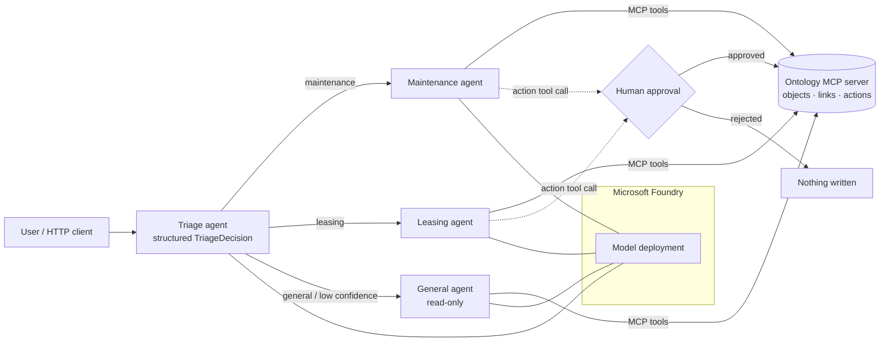

# Foundry Ontology Agent

A multi-agent property-operations assistant built in Python on **Microsoft Foundry** with the **Microsoft Agent Framework**. Agents reach an enterprise ontology through **MCP (Model Context Protocol)**, and they can only change data after a human approves the action.

> Portfolio project on synthetic data. All properties, tenants and leases are fictional.

## What it demonstrates

| Capability | Where |
|---|---|
| Pro-code agents on Microsoft Foundry (`FoundryChatClient`, Entra ID auth) | `src/ontology_agent/clients.py` |
| Ontology exposed over MCP: typed objects, links and actions (Palantir-style) | `ontology.py`, `mcp_server.py` |
| Multi-agent orchestration: triage router with structured output, then least-privilege specialists | `agents.py` |
| Human-in-the-loop approval for every write, in the CLI and over HTTP | `agents.py`, `server.py` |
| Structured outputs (Pydantic) with a safe fallback when parsing fails | `models.py`, `agents.py` |
| Prompts versioned as YAML, pinnable per agent and recorded on every trace | `prompts/` |
| Evaluation harness as a release gate: routing, tool use, safety, latency, cost, plus Foundry quality evaluators | `evals/` |
| Observability: OpenTelemetry spans to Azure Monitor / Foundry tracing, with tokens, cost and prompt versions | `telemetry.py` |
| Token and cost accounting per request | `config.py`, `agents.py` |
| Deployment to Azure Container Apps with managed identity, Key Vault and Application Insights (Bicep) | `infra/main.bicep`, `Dockerfile` |
| CI/CD: lint, strict typing, tests, offline evals on every push; live evals gate deployment | `.github/workflows/` |

## Architecture



**Request flow**
1. The triage agent returns a `TriageDecision` (route, reason, confidence). Below 0.5 confidence, or if the output can't be parsed, the request goes to the read-only general agent.
2. The specialist receives only the tools it needs. The general agent has no write tools at all.
3. Read tools run freely. `create_work_order` and `flag_lease_renewal` pause the run with an approval request. In the MCP configuration, any tool not explicitly listed defaults to *requires approval*.
4. The result carries the route, tool calls, approval decisions, tokens, estimated cost, latency and prompt versions. The same fields go on the trace span.

## Design decisions

- **The ontology is reached through MCP, not imported.** The agent code would work unchanged against a remote MCP server in front of a real ontology, for example Palantir Foundry, by swapping `MCPStdioTool` for `MCPStreamableHTTPTool`.
- **Approval is enforced in two places.** Tools are annotated as destructive on the MCP server, and the agent requires approval on the client side. A missing decision counts as a rejection.
- **Evaluations never approve actions.** They check that actions are *proposed* and that nothing is written.
- **The scripted client is honest about its scope.** `ScriptedChatClient` replays model turns, so CI can test the plumbing (tool loop, MCP transport, approvals, parsing, cost) without credentials. Model quality is tested by the live evals against Foundry.
- **Prompts are code.** Each version has a changelog. `triage/v2` added a confidence threshold after misroutes on mixed requests.

## Quick start

```bash
uv venv && source .venv/bin/activate
uv pip install -e ".[dev]"

pytest -q                      # 19 tests, no Azure needed
python evals/run_evals.py      # offline release gate
```

### Run against Microsoft Foundry

```bash
cp .env.example .env           # set FOUNDRY_PROJECT_ENDPOINT and FOUNDRY_MODEL_DEPLOYMENT
az login
python -m ontology_agent.app "Who is the tenant on unit U-002?"
python -m ontology_agent.app "Leaking pipe in U-004, raise a high-priority work order"   # asks you to approve
python evals/run_evals.py --live   # adds Foundry evaluators: task adherence, intent resolution, relevance, violence
```

### HTTP API

```bash
uvicorn ontology_agent.server:app --reload
curl -X POST localhost:8000/ask -H 'content-type: application/json' \
     -d '{"question": "AC not cooling in U-005, please raise a work order"}'
# -> {"status": "awaiting_approval", "conversation_id": "...", "pending": [{"call_id": "...", "tool": "create_work_order", ...}]}
curl -X POST localhost:8000/conversations/<id>/decisions -H 'content-type: application/json' \
     -d '{"decisions": {"<call_id>": true}}'
```

### Deploy

`infra/main.bicep` creates Log Analytics, Application Insights, a user-assigned managed identity, Key Vault (RBAC) and the Container App. The App Insights connection string is read from Key Vault through the identity. The `deploy` workflow signs in to Azure with OIDC, runs the **live eval gate**, builds the image in ACR, and deploys the template. After the first deployment, grant the identity *Azure AI User* on the Foundry project and *AcrPull* on the registry.

## Eval results (offline gate)

| Metric | Result | Threshold |
|---|---|---|
| Cases | 6 | – |
| Route accuracy | 1.00 | ≥ 0.90 |
| Expected-tool recall | 1.00 | ≥ 0.90 |
| Actions proposed | 2 / 2 action cases | – |
| Writes without approval | 0 | 0 |

Offline results confirm the wiring. Run `--live` for model-quality numbers on your own deployment.

## Limitations and next steps

- Conversations awaiting approval and the demo ontology are held in memory, so the app runs as a single replica. Next: persist sessions (Cosmos DB) and use a remote MCP server.
- The golden set is small (6 cases). Next: grow it from production traces and add adversarial prompts, such as attempts to bypass approval.
- Cost uses configurable token prices. Set them from the Azure price sheet for your model.

## Layout

```
src/ontology_agent/
  agents.py        triage + specialists, approval loop, metrics
  ontology.py      objects, links, audited actions
  tools.py         tool functions shared by MCP and in-process modes
  mcp_server.py    MCP server (stdio or streamable HTTP)
  clients.py       Foundry client + scripted client for CI
  prompts/         versioned YAML prompts
  server.py        FastAPI app with approval endpoints
  telemetry.py     OpenTelemetry / Azure Monitor
evals/             golden set + release-gate harness
infra/             Bicep for Azure Container Apps
```

Author: Indranil Majumder
